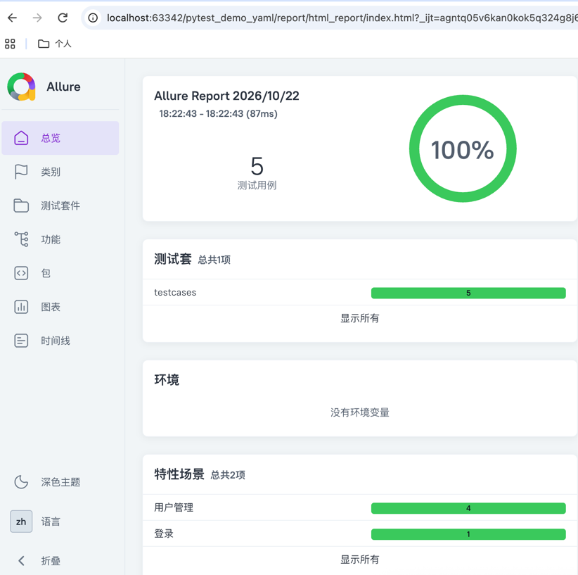
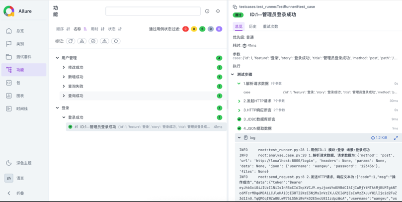

# 🚀 企业级接口自动化测试框架 (Pytest + YAML + Allure)

## 📖 项目简介

本项目是一个基于 Python 的现代化接口自动化测试框架，专为解决复杂业务流与企业级测试痛点而设计。采用 **数据驱动 (YAML)** 模式，实现了底层逻辑与测试数据的彻底解耦。具备全局鉴权注入、上下文状态流转、多层级断言、真实文件流防假校验、以及测试数据自动清理等企业级特性。

## ✨ 核心特性 (Highlights)

*   **多模块数据驱动**：按业务拆分 YAML 文件，支持动态加载与 `is_true` 开关过滤。
*   **无感鉴权与全局上下文**：基于 Pytest 的 `Session` 级 Fixture 实现自动登录取 Token，并利用 `global_context` 字典实现跨用例的数据提取与安全流转，彻底消除用例间的强耦合。
*   **安全的变量替换**：基于正则表达式实现 `${变量名}` 替换，精准识别完全匹配（保留 `int` 等原始类型）与拼接匹配（强转 `str`），并内置防御性断言，变量缺失时直接抛出异常（Fail Fast）。
*   **真实文件流防假校验**：底层强制 `open(rb)` 读取文件流，彻底杜绝“纯字符串传参”导致的 0 字节假通过。并在请求发送中利用 `try...finally` 强制释放文件句柄，防止高并发下的资源泄漏。
*   **双重断言机制**：支持基于 `JSONPath` 的 HTTP 响应断言，以及基于 `DictCursor` 的 JDBC 数据库 SQL 断言（支持单字段与多字段字典精准校验）。
*   **全生命周期数据治理**：采用 `auto_test_` 前缀规范，利用 Fixture 的 `yield` 机制，在测试前后自动执行 `DELETE` 清理脚本，保证测试环境持久纯净。
*   **精美的可视化报告**：深度集成 Allure，支持动态层级分类、日志脱敏附件与 Token 遮蔽展示。

## 📂 目录结构

├── config/             # 环境配置 (BASE_URL, 数据库配置等)
├── data/               # YAML 测试用例数据 (多文件模块化)
├── file/               # 测试文件上传目录
├── testcases/          # 测试执行入口 (test_runner.py)
├── utils/              # 核心工具类
│   ├── analyse_case.py # 请求解析与变量安全替换
│   ├── asserts.py      # HTTP与数据库双重断言
│   ├── db.py           # 数据库连接与执行工具
│   ├── send_request.py # HTTP 请求发送与资源释放
│   └── yaml_utils.py   # YAML 数据加载与过滤
├── conftest.py         # Pytest 全局夹具 (Session 级鉴权与数据清理)
├── pytest.ini          # Pytest 配置
└── requirements.txt    # 依赖库

## 🚀 快速开始

1. **安装依赖**：`pip install -r requirements.txt`
2. **配置环境**：修改 `config/config.py` 中的 `BASE_URL`、登录账号密码及数据库连接信息。
3. **执行测试**：在终端运行 `pytest`
4. **生成报告**：运行 `allure serve ./allure-results`

## 📸 测试报告效果展示

### 1. 测试套件与用例执行概览

### 2. 详细步骤与断言日志追踪

## 🎯 关键技术实战说明

### 1. 接口依赖与上下文传递
在 YAML 中通过 jsonExData 提取上游接口返回值（如 user_id），存入 global_context；下游接口直接通过 ${user_id} 引用。底层结合 Pytest Fixture 与字典的引用传递，完美解决接口依赖，同时支持单条用例独立调试。

### 2. 测试数据与脏数据清理
框架层维护了 cleanup.yaml 文件。在 conftest.py 的 global_context Fixture 中，利用 yield 语法在测试会话开始前和结束后，自动遍历执行清理 SQL（结合 LIKE 'auto_test_%' 前缀）。无需测试人员在每条用例里手动写 DELETE，实现了对测试人员零心智负担的环境治理。

### 3. 文件上传与内存泄漏防范
针对表单文件上传（multipart/form-data），框架在 analyse_case 中以 rb 模式打开文件流，并在请求发送的 finally 块中遍历关闭文件句柄，彻底杜绝了句柄泄漏，保障了自动化框架在长时间运行时的稳定性。